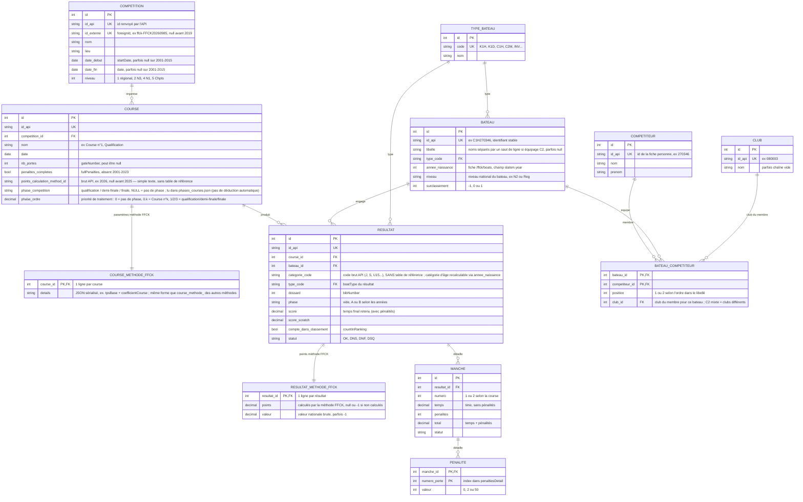

# Schéma de base de données : classement slalom (FFCK)



## Recalculer rang et catégorie d'âge

```sql
-- Rang dans la course, par type de bateau et phase (A/B séparées) :
-- ~96% de concordance avec le champ "rank" de l'API sur les données collectées.
SELECT r.id,
       RANK() OVER (PARTITION BY r.course_id, r.type_code, r.phase
                    ORDER BY COALESCE(NULLIF(r.score_scratch, 0), r.score) ASC) AS rang
FROM resultat r
WHERE r.compte_dans_classement = 1;

-- Catégorie d'âge à une année donnée (ex. 2025, codes U12/U15/U18 depuis 2021) :
SELECT r.id,
       CASE WHEN 2025 - b.annee_naissance < 12 THEN 'U12'
            WHEN 2025 - b.annee_naissance < 15 THEN 'U15'
            WHEN 2025 - b.annee_naissance < 18 THEN 'U18' END AS categorie_age
FROM resultat r JOIN bateau b ON b.id = r.bateau_id
WHERE b.annee_naissance IS NOT NULL;
```

## Phases des courses (qualification / demi-finale / finale)

L'API n'a pas de champ "phase" dédié au niveau course : la phase se lit dans le **nom de la course** (`race.name`). Comme il y a des subtilités (des courses appelées "Finale" qui comportent en réalité plusieurs phases), la phase **n'est pas déduite automatiquement** :

- le mapping nom → phase est stocké dans **`phases_courses.json`** (clé = nom normalisé — casse/accents/espaces ignorés ; valeur = `{"brut": ..., "phase": ...}`) ;
- il est initialisé depuis `old_scrapper_infos/phase_simplification.pkl` (`python3 collecte_bdd.py --init-phases`) : `(no_phase_list, qualif_list, demi_list, final_list) = pickle.load(f)` ;
- pendant la collecte, un **nom inconnu** fait émettre un bip au script, qui demande la phase interactivement et l'enregistre dans le JSON pour les prochaines fois ;
- avec `--no-interactif` (run en arrière-plan sans terminal), les noms inconnus passent à `NULL` et sont loggés dans `phases_inconnues.log` ;
- après un run `--no-interactif` (ou une édition manuelle du JSON), lancer **`python3 collecte_bdd.py --revoir-phases`** (post-traitement intégré à la collecte) : il rejoue les noms du log interactivement (bip + saisie), enregistre les réponses dans `phases_courses.json`, répercute dans la base (`UPDATE course SET phase_competition, phase_ordre`) et archive le log en `.old`. Options : `--revoir-phases-tout` (revoir tous les noms de la base), `--dry-run` (JSON seul, base inchangée).

Stockage sur `COURSE` :

| colonne | valeurs |
|---|---|
| `phase_competition` | `'qualification'`, `'demi-finale'`, `'finale'`, ou `NULL` (pas de phase) |
| `phase_ordre` | `0` = pas de phase, `0.k` = nom "Course n°k" (0.1, 0.2, 0.3...), `1`/`2`/`3` = qualification/demi-finale/finale. Saisie manuelle possible : répondre `0.k` (ex `0.3`) lors de l'interaction → `phase_competition = NULL` + `phase_ordre = 0.k` explicite (champ `"ordre"` dans le JSON), prioritaire sur le calcul auto |

Ordre de traitement des courses d'une compétition :

```sql
SELECT * FROM course WHERE competition_id = ?
ORDER BY date, phase_ordre, id_api;
```

## Courses par équipe (non sauvegardées)

On ne garde que les compétitions individuelles. `team_events.json` = `{"team": [...], "non_team": [...]}` (converti depuis l'ancien `team_event_classification.pkl` ; les noms sont ceux de l'ancien scrapper).

Détection **au niveau course** (un event peut mélanger courses individuelles et par équipe, ex l'event `...Master-Equipage` avec la course `Frances par équipe`) : candidat si `equipe`/`patrouille` est dans `race.name` ou `ev.name` (normalisé = unidecode + lower). Matching contre le JSON : égalité normalisée ou préfixe avec un nom testé d'au moins 25 caractères (strict, pour éviter les faux positifs silencieux ; un faux négatif tombe sur la question interactive).

- nom connu (`team`/`non_team`) → décision appliquée, la course team **n'est pas insérée**
- candidat inconnu → bip + question `[o/n]`, réponse enregistrée dans `team_events.json` (`"event | course"`) ; en `--no-interactif` : la course est **sautée** et loggée dans `team_events_inconnus.log`

## Tester d'autres méthodes de classement

Aucune modification du schéma de base n'est nécessaire. Le pattern (voir `exemple_methode_test.py`) :

1. créer une table dédiée à la méthode, avec la forme propre à cette méthode :
   `course_methode_<nom>(course_id PK, ...)` pour ses paramètres de course,
   `resultat_methode_<nom>(resultat_id PK, ...)` pour ses résultats calculés ;
2. la remplir par calcul à partir des données brutes (`resultat`, `manche`, `penalite`, `course_methode_ffck`...) ;
3. comparer avec la méthode FFCK (`resultat_methode_ffck`).

## Évolutions du format prises en compte

- **La course est l'unité de résultats, pas la compétition.** Une compétition contient 1 à 4 courses (manches) distinctes, chacune avec son propre classement.
- **Le bateau, pas le compétiteur, participe.** Les équipes C2 ont deux membres (le champ `boat.label` les sépare par un retour à la ligne) et peuvent représenter **deux clubs différents**, d'où le club porté par chaque membre (`BATEAU_COMPETITEUR.club_id`).
- **Année de naissance** : disponible sur la fiche de chaque bateau (endpoint `/ffck/boats/{id}`, champ `slalom.year`), portée par le bateau ; sur un C2 les deux équipiers partagent la même valeur.
- **Catégories hétérogènes** : codes historiques à une lettre (J, C, S, V...) jusqu'au début des années 2020, puis U12/U15/U18/M35 depuis 2021. Le code brut est conservé dans `resultat.categorie_code` (texte libre) ; la catégorie d'âge se recalcule depuis l'année de naissance.
- **Points** : calculés par course selon la méthode FFCK (`baseTime`, `coefficient` → JSON `details` de `course_methode_ffck` ; identifiant de méthode brut → `course.points_calculation_method_id`, renseigné seulement depuis 2025). Les `points`/`valeur` de chaque résultat sont stockés dans `resultat_methode_ffck` et peuvent valoir `-1`.
- **Manches** : 1 ou 2 manches par course selon l'époque, d'où la table `MANCHE` séparée de `RESULTAT`.
- **Pénalités** : `penaltiesDetail` est un tableau indexé par porte ; il est rattaché à la manche.
- **Miscibilité** : `phase` (A/B, courses à phases), `statut` (OK/DNS/DNF/DSQ), et le type `INV` (invités, hors classement, `countInRanking` à faux) sont conservés en colonnes dédiées.
- **Traçabilité** : les colonnes `id_api` (identifiants de l'API) et `id_externe` (`foreignId`, absent avant 2019) facilitent les mises à jour incrémentales.
